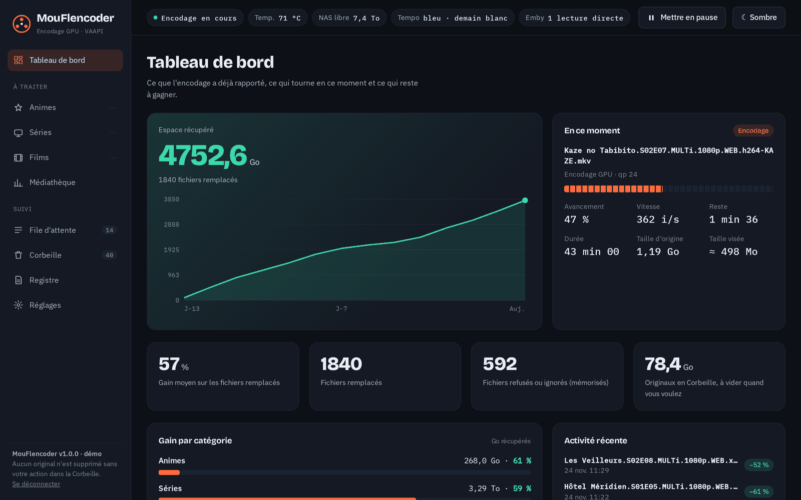
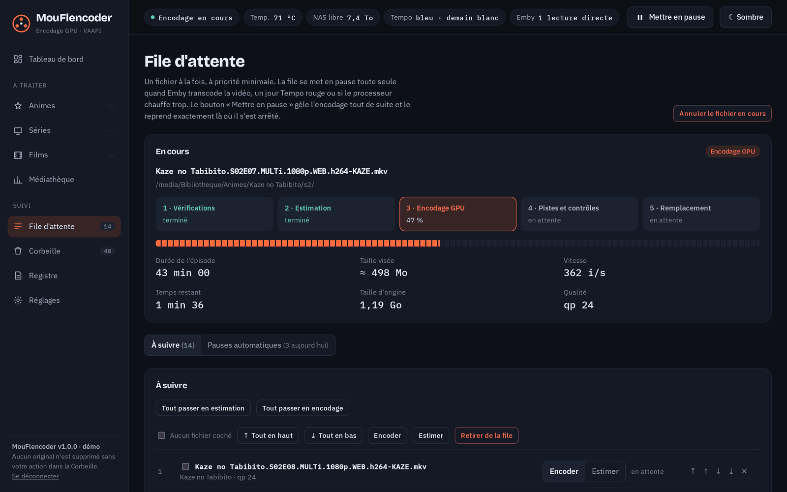
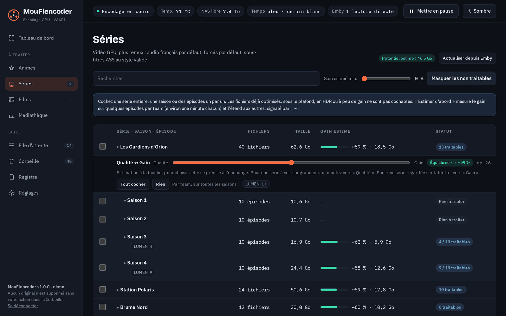
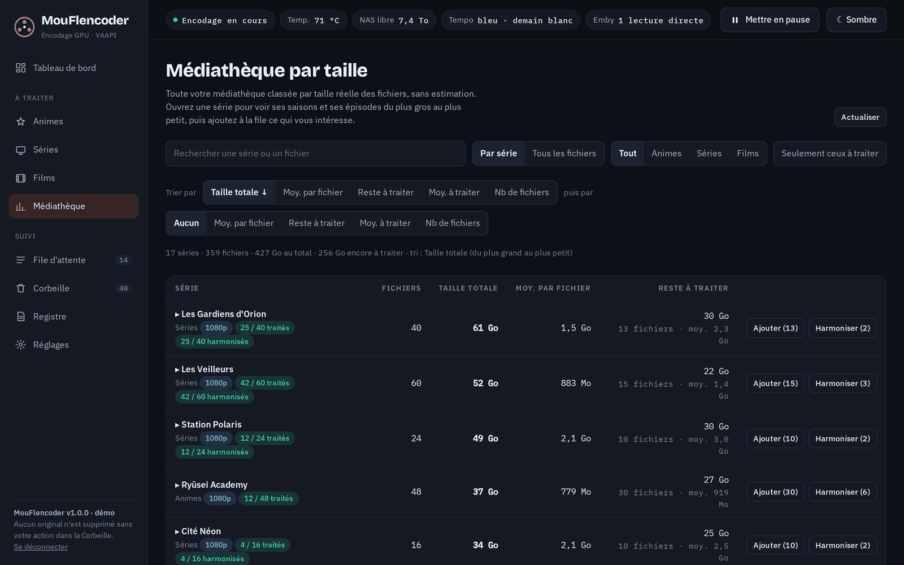
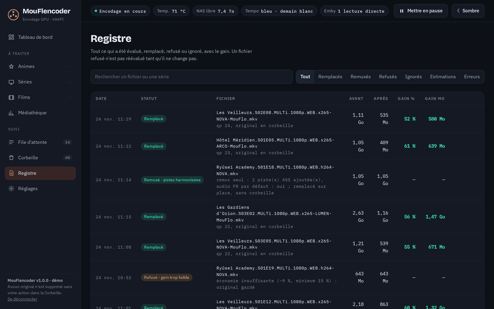
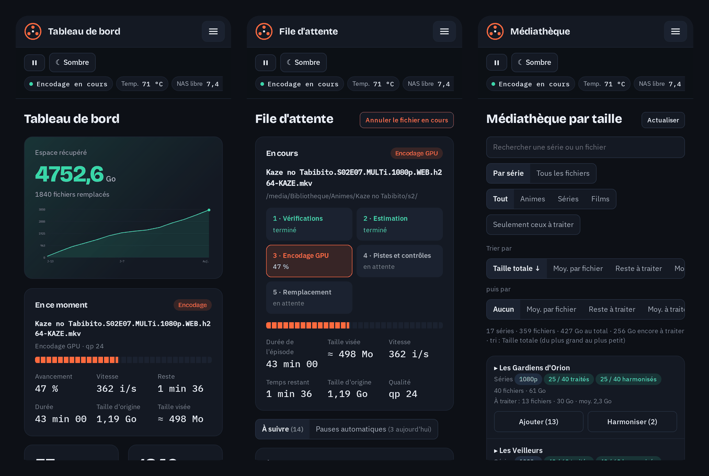
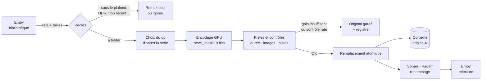

<div align="center">


# MouFlencoder

**Réencode toute une médiathèque Emby en HEVC 10 bits sur le GPU, sans jamais perdre un original.**

<p>


</p>



</div>

---

MouFlencoder est un service web auto-hébergé qui parcourt une médiathèque Emby, repère les fichiers trop lourds, les réencode avec le GPU Intel (VAAPI, `hevc_vaapi` 10 bits) et remplace l'original **seulement si le gain est réel et si le résultat passe tous les contrôles**. L'original part dans une corbeille sur le NAS : rien n'est supprimé sans un clic de votre part.

Il a été écrit pour remplacer Tdarr sur un serveur domestique, avec une idée fixe : **voir et piloter ce qui est fait, série par série, depuis le téléphone**.

> [!NOTE]
> **En production depuis novembre 2026** sur une médiathèque de 51 To : **4,3 To récupérés**, 3 634 fichiers réencodés (gain moyen **57 %**), 6 654 fichiers harmonisés, zéro original perdu.

## Sommaire

- [Points forts](#points-forts)
- [Aperçu](#aperçu)
- [Comment ça marche](#comment-ça-marche)
- [Installation](#installation)
- [Essayer sans rien installer : le mode démo](#essayer-sans-rien-installer--le-mode-démo)
- [Réglages](#réglages)
- [Sécurité](#sécurité)
- [Architecture du code](#architecture-du-code)
- [API](#api)
- [Limites connues](#limites-connues)

## Points forts

| | |
|---|---|
| 🎯 **Taille visée, pas qp fixe** | Chaque épisode vise ~375 Mo de vidéo pour 22 min. Le qp est déduit de ce que **la même série** a réellement donné (registre), avec l'audio propre à chaque fichier. Plafond de qualité réglable (`qp_max`). |
| 🛡️ **Remplacement sûr** | Copie à côté (`.mfe.tmp`), lien en dur de l'original dans la Corbeille, renommage atomique. Contrôles avant remplacement : durée, nombre d'images, pistes, codec, résolution. |
| 🔥 **Respect de la machine** | `nice 19` + `ionice` idle, ralentissement progressif au-dessus de 85 °C, gel à 92 °C, pause quand Emby transcode une vidéo. La pause manuelle gèle ffmpeg (`SIGSTOP`) et reprend à l'image près. |
| ⚡ **Tarif Tempo (EDF)** | Couleur du jour relevée toute seule : jamais d'encodage un jour rouge, encodage la nuit les jours blancs. Secours possible depuis Home Assistant. |
| 🎚️ **Curseur Qualité ↔ Gain** | Par série, avec estimation sur extraits et extrapolation par team. Les fichiers déjà optimisés, sous le plafond ou à faible gain ne sont même pas cochables. |
| 🎧 **Harmonisation des pistes** | Audio français par défaut, sous-titres forcés en tête, SRT convertis en ASS stylés. Possible **sans réencoder** (remux seul, HDR10 et Dolby Vision conservés). |
| 🔁 **Sonarr / Radarr / Emby** | Renommage automatique (`[team-MouFlo]`), relecture des pistes par Emby, envois groupés pour ne pas saturer les services pendant les gros lots. |
| 📱 **Application web installable** | Interface sombre/claire, pensée mobile (cartes sous 820 px), installable en PWA. Alertes Telegram : fin de file, bilan quotidien, erreurs, paliers de 100 Go. |

## Aperçu

<table>
<tr>
<td width="50%"><br><sub><b>File d'attente</b> : les 5 étapes du fichier en cours, vitesse, taille visée, ordre de la file.</sub></td>
<td width="50%"><br><sub><b>Séries</b> : curseur Qualité ↔ Gain, gain estimé par saison et par team.</sub></td>
</tr>
<tr>
<td><br><sub><b>Médiathèque</b> : tout classé par taille réelle, tris multiples, « Ajouter » ou « Harmoniser ».</sub></td>
<td><br><sub><b>Registre</b> : chaque décision expliquée (remplacé, refusé, ignoré, harmonisé…).</sub></td>
</tr>
</table>

<div align="center">
<br>
<sub>Sur téléphone : tableau de bord, file d'attente, médiathèque.</sub>
</div>

<sub>Captures réalisées avec le <a href="#essayer-sans-rien-installer--le-mode-démo">mode démo</a> : séries et chiffres fictifs.</sub>

## Comment ça marche



Chaque fichier traverse cinq étapes visibles dans l'interface :

1. **Vérifications** : âge minimum (15 min), définition, HDR, entrelacement, codec. Les sources sans gain possible (x265 déjà léger, audio très lourd) sont sautées d'office.
2. **Estimation** : qp choisi d'après l'historique du fichier, de la saison, de la team puis de la série. Mode « Estimer » possible : 3 extraits de 40 s à 5 niveaux de qualité.
3. **Encodage GPU** : `hevc_vaapi`, profil `main10`, CQP, B-frames `-bf 3 -b_depth 3`, toutes les pistes audio/sous-titres copiées. Décodage GPU quand la source le permet, sinon voie mixte ou processeur, avec repli automatique.
4. **Pistes et contrôles** : remux (`mkvmerge`), sous-titres ASS, marqueur de traitement ; nombre d'images et durée comparés à l'original. Nouvel essai automatique si la sortie est hors cible (trop petite ou trop grosse).
5. **Remplacement** : uniquement si le gain dépasse le minimum (15 % et 150 Mo / 22 min par défaut).

## Installation

### Prérequis

| | |
|---|---|
| Système | Linux (testé sur Debian 13), Python 3.11+ |
| GPU | Intel avec VAAPI et encodage HEVC 10 bits (`/dev/dri/renderD128`) |
| Outils | `ffmpeg` (avec VAAPI), `ffprobe`, `mkvtoolnix` (`mkvmerge`, `mkvextract`, `mkvpropedit`) |
| Médiathèque | Montée localement (NFS/SMB), en lecture-écriture, **sur le même chemin qu'Emby** |
| Emby | Une clé d'API (Sonarr, Radarr et Telegram sont facultatifs) |

L'installation de référence tourne dans un conteneur LXC Proxmox avec le GPU intégré partagé (`/dev/dri`).

### Étapes

```bash
# 1. Paquets
apt install ffmpeg mkvtoolnix python3-flask intel-media-va-driver-non-free vainfo
vainfo | grep -i hevc            # doit lister VAProfileHEVCMain10 / VAEntrypointEncSlice

# 2. Code
git clone https://github.com/mouflo/MouFlencoder.git /opt/mouflencoder
cd /opt/mouflencoder

# 3. (facultatif) police des sous-titres ASS, voir fonts/README.md
cp /chemin/vers/trebucbd.ttf fonts/trebucbd_0.ttf

# 4. Service
cp deploy/mouflencoder.service /etc/systemd/system/
nano /etc/systemd/system/mouflencoder.service   # MFE_NAS_ROOT = racine de la médiathèque
systemctl daemon-reload && systemctl enable --now mouflencoder
```

Ouvrez ensuite `http://<adresse>:8300` **depuis le réseau local** : la page « Première connexion » crée votre identifiant et votre mot de passe. Puis, dans **Réglages > Accès et clés**, saisissez l'adresse et la clé d'Emby (bouton *Tester*), et éventuellement Sonarr, Radarr et Telegram.

> [!IMPORTANT]
> **Le mode test est activé au premier démarrage** : il ignore les plages horaires Tempo (sauf les jours rouges) pour que vous puissiez essayer tout de suite. Commencez par une seule série, regardez le résultat sur votre télé, puis désactivez-le dans Réglages.

### Variables d'environnement

| Variable | Défaut | Rôle |
|---|---|---|
| `MFE_NAS_ROOT` | `/mnt/media` | Racine de la médiathèque. Les dossiers `MouFlencoder/{Corbeille,Registre,Remplaces}` y sont créés. |
| `MFE_EMBY_HOST` | `http://localhost:8096` | Adresse Emby par défaut (modifiable ensuite dans l'interface). |
| `MFE_WORK` | `/var/tmp/mouflencoder` | Dossier de travail local (prévoir ~2× la taille du plus gros fichier). |

Les catégories sont reconnues par le chemin : `/Manga/` → animes, `/Films` ou `/Movies/` → films, le reste → séries.

### Outils Dolby Vision (facultatif)

`dv.py` (expérimental, désactivé par défaut) sait extraire et réinjecter le RPU Dolby Vision. Il attend [`dovi_tool`](https://github.com/quietvoid/dovi_tool) et [`hdr10plus_tool`](https://github.com/quietvoid/hdr10plus_tool) dans `bin/`. Ces binaires ne sont pas fournis ici : téléchargez-les depuis leurs dépôts.

## Essayer sans rien installer : le mode démo

```bash
python3 demo/demo_server.py      # puis http://127.0.0.1:8301
```

Le serveur de démo sert la vraie interface avec une médiathèque **fictive** générée à la volée : pas de vidéo, pas d'Emby, pas de GPU, aucune dépendance hors Python. Les boutons répondent sans rien modifier. C'est aussi lui qui sert aux captures de ce README.

## Réglages

Tout se règle dans l'interface (**Réglages**) et se garde dans la base SQLite. Les principaux :

| Réglage | Défaut | Effet |
|---|---|---|
| Taille visée animes / séries / films | 375 Mo / 22 min | Vidéo seule, proportionnelle à la durée de l'épisode |
| Plafond de qualité (`qp_max`) | 26 | Le qp ne dépasse jamais cette valeur, même si la taille visée n'est pas atteinte |
| Plafond de non-intervention | 550 Mo (animes), 900 Mo (séries, films) | En dessous, le fichier n'est pas réencodé |
| Gain minimum | 15 % et 150 Mo / 22 min | Sinon l'original est gardé (statut « Refusé ») |
| Sauter les x265 légers | 700 Mo / 22 min | Source déjà compressée : pas d'encodage |
| Sauter si vidéo < 128 % de la cible | 128 % | Audio très lourd ou source déjà efficace |
| Température cible / pause | 85 °C / 92 °C | Ralentissement progressif, puis gel de ffmpeg |
| Pause si Emby transcode | activé | La lecture passe avant l'encodage |
| Harmoniser les pistes | activé | Remux seul des fichiers non réencodables d'une saison traitée |
| Renommage Sonarr/Radarr | désactivé | Ajoute `-MouFlo` à la team et prévient Emby |
| 4K | désactivé | Le GPU Intel ne bat pas les encodages 4K logiciels existants |

**Tempo (hors mode test)** : rouge → jamais ; blanc → la nuit (22 h – 6 h) ; bleu → la nuit, et aussi le jour s'il y a au moins 10 fichiers en attente ; couleur inconnue → pause.

## Sécurité

- **Aucun secret dans le code ni dans le dépôt.** Identifiant, hachage du mot de passe, clés Emby/Sonarr/Radarr et jeton Telegram vivent dans `data/secrets.env` (droits `600`), écrit par l'application elle-même.
- La création du compte n'est possible que depuis le réseau local en accès direct (jamais à travers un proxy). `set-login.sh` sert seulement de secours.
- Les clés ne sont jamais renvoyées à la page : seuls leurs 4 derniers caractères s'affichent.
- Le webhook Home Assistant (`POST /hook/tempo`, en-tête `X-MFE-Secret`) utilise un secret généré dans l'interface, montré une seule fois ; seul son hachage est gardé.
- Derrière un reverse proxy HTTPS, l'application lit `X-Forwarded-*` (`ProxyFix`).

## Architecture du code

```
mouflencoder/
├── app.py              Routes Flask (interface + API JSON), port 8300
├── core.py             Moteur : base SQLite, bibliothèque Emby, file, choix du qp,
│                       encodage, garde thermique, Tempo, remplacement sûr, registre
├── media.py            Remux mkvmerge : ordre des pistes, SRT → ASS, marqueur, contrôles
├── renamer.py          Sonarr / Radarr / Emby, envois groupés après les lots
├── estimate.py         Estimation sur extraits (3 × 40 s, 5 niveaux de qp)
├── notify.py           Alertes Telegram
├── auth.py             Connexion, première connexion, session, secrets
├── emby_settings.py    Adresse et clé Emby (test de connexion)
├── dv.py               Chaîne Dolby Vision expérimentale (dovi_tool)
├── static/index.html   Interface complète (HTML/CSS/JS sans dépendance)
├── ui/mou-ui.css       Styles partagés (page de connexion)
├── icons/              Logo, icônes PWA, manifeste
├── demo/               Serveur de démonstration (données fictives)
├── deploy/             Service systemd
└── data/               (créé au démarrage) base SQLite, cache Emby, secrets — jamais versionné
```

Une seule dépendance Python : **Flask**. Tout le reste (Emby, Sonarr, Telegram, Tempo) passe par `urllib` de la bibliothèque standard.

## API

Toutes les routes demandent une session ouverte, sauf `/hook/tempo` (secret).

| Méthode | Route | Rôle |
|---|---|---|
| `GET` | `/api/state` | État en direct : fichier en cours, étape, %, vitesse, température, Tempo, Emby |
| `GET` | `/api/stats` | Espace récupéré, gain moyen, historique par jour et par catégorie |
| `GET` | `/api/library?cat=series` | Séries → saisons → épisodes, avec l'état de chaque fichier |
| `GET` | `/api/media` · `/api/media/files` | Médiathèque par taille réelle |
| `GET` `POST` | `/api/queue` · `/api/queue/add` · `move` · `remove` · `kind` · `cancel` | File d'attente |
| `POST` | `/api/pause` | Pause / reprise (gèle ffmpeg) |
| `GET` | `/api/registry` | Registre filtrable par statut et recherche |
| `GET` `POST` | `/api/trash` · `restore` · `delete` · `empty` | Corbeille (restauration à l'emplacement d'origine) |
| `GET` `POST` | `/api/settings` · `/api/prefs` | Réglages globaux et par série |
| `POST` | `/hook/tempo` | Couleur Tempo envoyée par Home Assistant : `{"today":"bleu","tomorrow":"rouge"}` |

## Limites connues

- **GPU Intel uniquement** (VAAPI). Pas de NVENC ni d'AMF pour l'instant.
- **4K / HDR / Dolby Vision** : jamais réencodés (seulement remuxés). À qualité égale, le GPU Intel dépense plus de bits que les bons encodages x265 logiciels.
- Un fichier M4V/MP4 passe par une copie MKV intermédiaire ; si le nombre d'images diffère, le remux est refusé et l'original reste intact.
- **L'espace n'est vraiment libéré qu'une fois la Corbeille vidée.** C'est voulu : vous videz quand vous avez vérifié.
- L'interface est en français.

## Licence

[MIT](LICENSE) © 2026 MouFlo.

<div align="center"><sub>Fait maison, pour une médiathèque qui déborde. 🎬</sub></div>
